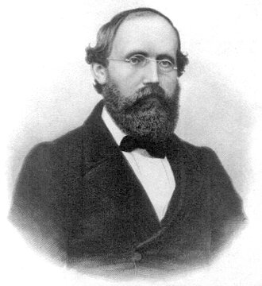

# 1부 — 수학 (1절 정수론)

수학의 난제는 다른 분야보다 "해결"의 기준이 분명하다. 증명이 동료 심사를 통과하고, 다른 수학자들이 독립적으로 재현하면 그 문제는 닫힌다. 그래서 이 부에 실은 목록은 상태 표기가 가장 단단하다.

상태 표기는 [부록 B](../appendix/b-legend.md)를 따른다. 번호는 1부 전체에서 공통으로 쓰는 고유 번호다. 절을 나눠 담아서 번호가 절 안에서 연속되지 않을 수 있다.

  
   베른하르트 리만(1826~1866). 1859년 논문에서 리만 가설을 제기했다. 사진: 위키미디어 커먼즈, 퍼블릭 도메인

| # | 문제 | 제기 | 현황 | 해결자/증명자 | 방법 요약 | 검증 상태 | 출처 |
|---|---|---|---|---|---|---|---|
| 1.1 | 리만 가설 | 베른하르트 리만, 1859 | ⏳ 미해결 | — | 제타 함수의 자명하지 않은 모든 근이 실수부 1/2 위에 있다는 추측. 수치적으로 수십억 개 근을 확인했지만 일반 증명은 없다 | — | 2026년 8월 앤트로픽, 2026년 10월 OpenAI가 각각 부분적 결과를 주장했다. 가설 자체는 여전히 미해결. [8부](../part8/02-2026-second-half.md) 8.9, 8.10 참고 |
| 1.7 | 페르마의 마지막 정리 | 피에르 드 페르마, 1637년경 | ✅ 해결 | 앤드루 와일스 (리처드 테일러와 공동으로 틈 보완), 1994~1995 | 타원곡선의 모듈성(반안정 경우)을 증명해 리벳의 정리와 결합, 3 이상의 지수에서 정수해가 없음을 보임 | 1995년 Annals of Mathematics 게재, 수학계에서 널리 재확인됨 | — |
| 1.10 | 콜라츠 추측 (3n+1 문제) | 로타르 콜라츠, 1937 | ⏳ 미해결 | — | 임의의 양의 정수에서 짝수면 반으로, 홀수면 3배하고 1을 더하는 과정을 반복하면 항상 1에 도달하는지를 묻는다 | 테런스 타오가 2019년 "거의 모든" 궤도가 거의 유계값에 도달함을 증명했으나, 모든 경우를 포괄하는 완전한 증명은 아니다 | — |
| 1.11 | 쌍둥이 소수 추측 | 고대부터 제기, 현대적 정식화는 19세기 | ⏳ 미해결 | — | 차이가 2인 소수 쌍이 무한히 많은지를 묻는다 | 장이탕이 2013년 소수 간격이 유계(7천만 이하)임을 증명했고, 폴리매스 프로젝트가 246까지 줄였다. 쌍둥이 소수 추측 자체(간격 2)는 아직 미해결 | — |
| 1.12 | 골드바흐 추측 | 크리스티안 골드바흐, 1742 | ⏳ 미해결 | — | 4보다 큰 모든 짝수는 두 소수의 합으로 쓸 수 있다는 추측 | 약한 골드바흐 추측(충분히 큰 모든 홀수는 세 소수의 합)은 하랄드 헬프고트가 2013년 증명. 원래의 추측(짝수, 두 소수)은 미해결 | — |
| 1.13 | ABC 추측 | 조제프 외스터레, 데이비드 매서, 1985 | ⚠️ 논쟁/정정됨 | 모치즈키 신이치가 증명을 주장, 2012 | "우주간 타이히뮐러 이론"이라는 새 이론으로 증명을 주장. 2021년 본인이 편집위원으로 있는 저널(RIMS)에 게재 | 페터 숄체와 야코프 스틱스가 2018년 핵심 단계에 빈틈이 있다고 지적했고, 주류 수학계는 증명으로 받아들이지 않는다. 이 아카이브에서는 미해결로 간주 | [확인 필요: 2026년 현재 학계 입장 최신 동향] |
| 1.16 | 빌 추측 | 앤드루 빌, 1993~1997 | ⏳ 미해결 | — | A^x + B^y = C^z (x, y, z가 모두 2보다 큰 양의 정수)를 만족하는 A, B, C는 반드시 공통 소인수를 가져야 한다는 추측. 페르마의 마지막 정리를 일반화한 형태다 | — | 빌 본인이 내건 상금은 2013년 미국수학회(AMS) 관리로 100만 달러로 올랐다 |
| 1.17 | 에르되시-스트라우스 추측 | 폴 에르되시, 에른스트 슈트라우스, 1948 | ⏳ 미해결 | — | 2 이상인 모든 정수 n에 대해 4/n = 1/x + 1/y + 1/z를 만족하는 양의 정수 x, y, z가 항상 존재한다는 추측. 매우 큰 범위까지 전산 검증됐지만 일반 증명은 없다 | — | — |
| 1.18 | 르장드르 추측 | 아드리앵마리 르장드르, 1808 | ⏳ 미해결 | — | n^2과 (n+1)^2 사이에 소수가 항상 적어도 하나 존재한다는 추측. 1912년 에드문트 란다우가 정리한 "소수에 관한 네 가지 미해결 문제" 중 하나다 | — | — |
| 1.19 | 세 세제곱수의 합으로 42 표현하기 | 세 세제곱수의 합 문제 자체는 오래됐고, 42는 2019년에 풀린 사례 | ✅ 해결(사례), 일반 문제는 미해결 | 앤드루 부커, 드루 서덜랜드, 2019 | x^3 + y^3 + z^3 = 42를 만족하는 정수해를 분산 컴퓨팅(Charity Engine)으로 찾아냈다. 같은 해 33에 대한 해도 먼저 찾았다 | 2019년 발표, 수학적으로 직접 검산 가능한 명시적 해라 검증이 간단하다. 다만 "9로 나눈 나머지가 ±4가 아닌 모든 정수가 세 세제곱수의 합으로 표현되는가"라는 일반 문제는 여전히 추측 단계다 | — |

## 참여하려면

증명을 새로 제출하려면 [부록 A](../appendix/a-registration.md)의 절차를 따른다. 출판 전 논문(preprint)만으로는 상태를 ✅로 바꾸지 않는다. 동료 심사를 통과하거나, 독립된 여러 수학자가 재현을 확인한 시점에 갱신한다.

## 더 깊이 알아보기

### 1.1 리만 가설

베른하르트 리만은 1859년, 베를린 학술원 회원으로 선출된 답례로 짧은 논문 한 편을 냈다. 본론은 소수의 개수를 세는 함수에 관한 것이었는데, 그 과정에서 제타 함수의 영점에 관한 추측을 거의 지나가듯 적어 넣었다. 리만 자신은 이 추측을 증명하려 애쓴 흔적을 남기지 않았다. 그런데 그 한 줄이 167년 동안 수학에서 가장 유명한 미해결 문제가 됐다. 1900년 다비트 힐베르트가 20세기 수학이 풀어야 할 23개 문제 목록에 넣었고, 2000년 클레이수학연구소가 다시 7개 밀레니엄 문제 중 하나로 골랐다. 그사이 여러 수학자가 증명을 발표했다가 철회하는 일이 반복됐다. 컴퓨터로 확인한 제타 함수의 영점은 수십억 개를 넘지만, 전부 가설대로 실수부 1/2 위에 있다는 사실이 "모든" 영점에 대한 증명은 아니다.

### 1.7 페르마의 마지막 정리

1637년, 피에르 드 페르마는 읽던 책의 여백에 짧은 메모를 남겼다. "나는 정말 놀라운 증명을 발견했지만, 여백이 너무 좁아 적을 수 없다." 그 뒤로 358년 동안 아무도 그 증명을 재현하지 못했다. 1986년, 당시 프린스턴대 교수였던 앤드루 와일스는 관련 정리(타원곡선과 모듈 형식을 잇는 다니야마-시무라 추측) 하나가 증명되면 페르마의 정리도 따라 나온다는 것을 알게 되자, 다른 모든 연구를 접고 다락방 서재에 틀어박혀 7년을 홀로 매달렸다. 1993년 케임브리지에서 세 번에 걸친 강연으로 증명을 발표했을 때 전 세계 언론이 몰렸지만, 몇 달 뒤 심사 과정에서 논리적 빈틈이 발견됐다. 와일스는 좌절 속에서 제자였던 리처드 테일러를 불러 함께 매달렸고, 1994년 9월 다른 접근법으로 그 틈을 메우는 데 성공했다. 와일스는 훗날 그 순간을 "내 연구 인생에서 가장 중요한 순간"이라 불렀다.

### 1.10 콜라츠 추측

규칙은 초등학생도 이해할 만큼 단순하다. 짝수면 2로 나누고, 홀수면 3을 곱하고 1을 더한다. 어떤 수에서 시작하든 결국 1에 도달한다는 게 추측이다. 1937년 로타르 콜라츠가 제기한 뒤로 수많은 수학자가 손을 댔지만 아무도 끝을 보지 못했다. 폴 에르되시는 이 문제를 두고 "수학이 아직 이런 문제를 풀 준비가 되어 있지 않다"고 말하며 증명에 현상금을 걸었을 정도다. 2019년 테런스 타오가 "거의 모든" 시작값이 거의 유계값까지 내려간다는 것을 증명해 큰 진전을 이뤘지만, 본인 스스로 이 방법으로는 완전한 증명에 도달하기 어렵다고 밝혔다. 단순해 보이는 규칙 뒤에 숨은 복잡성이 지금도 수학자들을 붙잡고 있다.

### 1.11 쌍둥이 소수 추측

2013년까지 장이탕은 뉴햄프셔대학교의 거의 무명 강사였다. 박사 학위를 받은 뒤 한동안 변변한 일자리를 구하지 못해 서브웨이 샌드위치 가게와 모텔에서 일하며 생계를 이었다는 사실이 나중에 알려지며 화제가 됐다. 그런 그가 2013년, 소수 사이의 간격이 7천만 이하로 유계라는 것을 증명한 논문을 Annals of Mathematics에 투고했다. 이렇다 할 발표 실적이 없는 무명의 연구자가 낸 논문이라 처음에는 의심의 눈초리도 있었지만, 심사 결과 증명은 완벽했다. 쌍둥이 소수 추측 자체(간격이 정확히 2)는 여전히 열려 있지만, 장이탕의 결과를 이어받은 폴리매스 프로젝트가 집단 협업으로 그 간격을 246까지 줄였다.

### 1.12 골드바흐 추측

1742년, 크리스티안 골드바흐는 레온하르트 오일러에게 보낸 편지에서 4보다 큰 모든 짝수가 두 소수의 합으로 쓰일 수 있다는 생각을 적었다. 오일러는 답장에서 이를 "완전히 확실한 정리"라고 평했지만, 정작 둘 다 증명은 내놓지 못했다. 그 뒤 거의 300년 가까이 이 추측은 손도 못 댄 채로 남았다. 2013년 하랄드 헬프고트가 방대한 컴퓨터 검증과 해석적 정수론을 결합해 약한 버전(충분히 큰 모든 홀수는 세 소수의 합)을 증명하면서 돌파구를 열었지만, 원래의 짝수 버전은 지금도 수치로 계속 확인될 뿐 증명되지는 않았다.

### 1.13 ABC 추측

2012년 교토대 모치즈키 신이치는 자신이 만든 "우주간 타이히뮐러 이론"이라는 새 이론 틀로 ABC 추측을 증명했다며 수백 쪽에 이르는 논문을 발표했다. 문제는 이 이론이 너무 독자적이어서, 세계적인 정수론 학자들조차 논문을 제대로 읽어낼 수 없었다는 데 있었다. 2018년 페터 숄체와 야코프 스틱스가 직접 교토까지 찾아가 모치즈키와 며칠간 토론했지만, 끝내 핵심 단계에서 견해차를 좁히지 못하고 돌아왔다. 모치즈키는 2021년 자신이 편집위원으로 있는 저널에 논문을 게재했고, 지금도 그 정당성을 둘러싼 논쟁은 가라앉지 않았다. 한 사람의 증명을 둘러싸고 세계 최고 수준의 수학자들이 몇 년째 합의에 이르지 못하는, 현대 수학사에서도 드문 사례다.

### 1.16 빌 추측

앤드루 빌은 직업 수학자가 아니라 은행업으로 성공한 텍사스의 사업가다. 혼자 정수론을 공부하다가 1990년대에 페르마의 마지막 정리를 일반화한 형태의 추측을 떠올렸고, 전문 수학자들에게 검토를 부탁했다. 아무도 반례도 증명도 내놓지 못하자, 빌은 직접 상금을 걸었다. 처음에는 5천 달러였던 상금은 아무도 풀지 못한 채 해가 거듭될수록 불어났고, 2013년 미국수학회가 관리를 맡으면서 100만 달러까지 올랐다. 전문 연구자가 아닌 사람이 제기한 추측이 학계의 정식 연구 대상이 된 드문 사례다.

### 1.17 에르되시-스트라우스 추측

폴 에르되시는 평생 집도 없이 동료 수학자들의 집을 전전하며 1,500편이 넘는 논문을 공동 집필한 괴짜 천재였다. 그가 1948년 에른스트 슈트라우스와 함께 던진 이 문제는 겉보기엔 단순한 분수식 퍼즐처럼 보인다. 에르되시는 평생 풀기 어려워 보이는 작은 문제들을 끊임없이 만들어 내고 직접 현상금을 걸곤 했는데, 이 추측도 그런 습관에서 나왔다. 컴퓨터로 매우 큰 범위까지 반례 없이 확인됐지만, 일반적인 증명은 70년 넘게 나오지 않고 있다.

### 1.18 르장드르 추측

1912년 케임브리지에서 열린 국제수학자대회에서 에드문트 란다우는 당대 정수론의 미해결 문제 중 특히 단순하면서도 손댈 수 없는 네 가지를 추려 소개했다. 르장드르 추측은 그중 하나였다. 이로부터 한 세기가 넘게 지났지만 네 문제 모두 여전히 미해결로 남아 있다. "란다우의 문제들"이라는 이름으로 묶여, 소수의 분포가 겉보기만큼 단순하지 않다는 것을 보여 주는 상징처럼 여겨진다.

### 1.19 세 세제곱수의 합으로 42 표현하기

x³+y³+z³=42를 만족하는 정수해를 찾는 문제는 오랫동안 풀리지 않은 채로 남아 있었다. 2019년, 브리스톨대 앤드루 부커와 MIT 드루 서덜랜드는 전 세계 자원봉사자들의 유휴 컴퓨터 자원을 모으는 분산 컴퓨팅 프로젝트(Charity Engine)를 동원해 몇 주 간격으로 33과 42의 해를 잇달아 찾아냈다. 42라는 숫자가 더글러스 애덤스의 소설 『은하수를 여행하는 히치하이커를 위한 안내서』에서 "삶과 우주, 그리고 모든 것에 대한 궁극적 질문의 답"으로 나온다는 사실 때문에, 이 발표는 수학계를 넘어 대중적으로도 화제가 됐다. 다만 이건 42라는 특정 숫자 하나를 해결한 것이고, "어떤 수들이 세 세제곱수의 합으로 표현되는가"라는 일반 문제는 지금도 추측 단계다.
