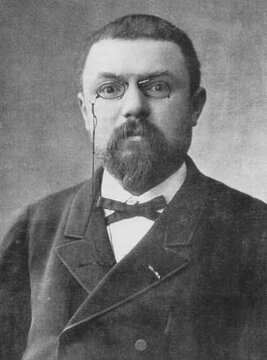
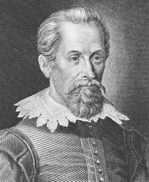

# 1부 — 수학 (2절 기하와 위상)

  
  
   앙리 푸앵카레(1854~1912, 왼쪽)와 요하네스 케플러(1571~1630, 오른쪽). 사진과 초상: 위키미디어 커먼즈, 퍼블릭 도메인

| # | 문제 | 제기 | 현황 | 해결자/증명자 | 방법 요약 | 검증 상태 | 출처 |
|---|---|---|---|---|---|---|---|
| 1.6 | 푸앵카레 추측 | 앙리 푸앵카레, 1904 | ✅ 해결 | 그리고리 페렐만, 2002~2003 | 리처드 해밀턴이 제안한 리치 흐름(Ricci flow)에 수술(surgery) 기법을 더해 완성. 단일 연결 3차원 다양체는 3차원 구와 위상동형이라는 것을 증명 | 2006년 전후 여러 검증팀이 세부를 확인. 필즈상(2006)과 밀레니엄상(2010) 모두 수상을 거절 | [확인 필요: 공식 검증 논문 세 팀의 명단과 발표 연도] |
| 1.9 | 케플러 추측 | 요하네스 케플러, 1611 | ✅ 해결 | 토머스 헤일스, 1998 (컴퓨터 보조) | 구를 쌓는 가장 밀도 높은 방법이 면심입방격자라는 것을 유한한 경우의 수 계산으로 증명 | 2014년 Flyspeck 프로젝트가 HOL Light와 Isabelle로 전 과정을 형식 검증 완료 | — |
| 1.20 | 움직이는 소파 문제 | 리오 모저, 1966 | ✅ 해결 | 백진언, 2024 | 직각으로 꺾인 통로를 통과할 수 있는 가장 넓은 평면 도형의 넓이를 구하는 문제. 1992년 조지프 저버가 제안한 "저버 소파" 모양이 최적이라는 것을, 컴퓨터 계산 없이 순수한 논증 119쪽으로 증명(저버 소파의 넓이는 통로 폭 1 기준 약 2.2195) | 2024년 11월 논문 공개(arXiv:2411.19826). 애널스 오브 매서매틱스에 투고돼 동료 심사가 진행 중이다. 주요 기하학자들의 초기 반응은 긍정적이었다 | [확인 필요: 동료 심사 완료 여부] |
| 1.21 | 외접 정사각형 문제 (토플리츠 추측) | 오토 토플리츠, 1911 | ⏳ 미해결 | — | 평면 위의 모든 단순 닫힌 곡선(조르당 곡선) 위에, 네 꼭짓점이 정사각형을 이루는 네 점이 반드시 존재하는지를 묻는다 | 곡선이 충분히 매끈하거나 convex(볼록)인 경우에는 증명됐다. 임의의 일반적인 조르당 곡선에 대해서는 미해결 | — |
| 1.22 | 고독한 주자 추측 | 외르크 빌스, 1967 (독립적으로 토머스 쿠식도 제기) | ⏳ 미해결 | — | 길이 1인 원형 트랙을 서로 다른 일정한 속력으로 도는 n명의 주자가 있을 때, 각 주자에게 다른 모든 주자로부터 거리 1/n 이상 떨어지는("고독한") 순간이 항상 있는지를 묻는다 | 주자 수가 적은 경우(7명까지)는 증명됐지만 일반적인 n에 대해서는 미해결 | [확인 필요: 2026년 기준 증명된 최대 주자 수] |

## 더 깊이 알아보기

### 1.6 푸앵카레 추측

앙리 푸앵카레는 1904년 위상수학 논문 말미에 이 질문을 거의 지나가는 말처럼 던졌다. "이 질문이 우리를 너무 멀리 끌고 갈 것 같다"는 말과 함께였다. 그 짧은 질문이 20세기 수학에서 가장 중요한 미해결 문제 중 하나로 자라났다. 2002년과 2003년, 러시아 수학자 그리고리 페렐만은 학술지 투고 없이 세 편의 논문을 인터넷 아카이브(arXiv)에 그냥 올렸다. 리처드 해밀턴이 수십 년에 걸쳐 쌓아 올린 리치 흐름 이론에 수술 기법을 더해 완성한 증명이었다. 여러 검증팀이 몇 년에 걸쳐 세부를 확인한 끝에 증명은 인정받았지만, 페렐만은 2006년 필즈상을, 2010년에는 100만 달러 밀레니엄상까지 거절했다. 상금 수여 기준이 해밀턴의 기여를 충분히 인정하지 않는다는 것이 이유 중 하나로 전해진다. 그는 이후 상트페테르부르크의 어머니 집에 머물며 수학계와 거리를 뒀다.

### 1.9 케플러 추측

1611년 요하네스 케플러는 자신을 후원하던 귀족에게 바치는 신년 선물로 짧은 글을 썼다. 눈송이의 육각형 구조를 이야기하다가, 구슬 장수가 구슬을 쌓듯 면심입방격자로 구를 쌓는 방법이 가장 밀도가 높다는 추측을 슬쩍 덧붙였다. 과일 장수나 포탄을 쌓아 본 사람이라면 누구나 "당연하다"고 여길 법한 이 추측은, 그러나 증명이 나오기까지 387년이 걸렸다. 1998년 토머스 헤일스는 가능한 배치를 유한한 경우로 줄인 뒤 컴퓨터로 전부 확인하는 방식의 증명을 내놓았다. Annals of Mathematics의 심사위원단은 4년에 걸쳐 검토한 끝에, 증명이 "99% 확실히" 맞는 것 같지만 모든 계산을 손으로 검증할 수는 없었다는 이례적인 소견을 냈다. 이 찜찜함을 해소하려고 헤일스는 이후 10년 넘게 팀을 꾸려 증명 전체를 두 개의 정리 증명기(HOL Light, Isabelle)로 한 줄 한 줄 형식 검증했고, 2014년 Flyspeck 프로젝트 완료를 선언했다.

### 1.20 움직이는 소파 문제

"직각으로 꺾인 복도를 돌 수 있는 가장 큰 소파는 얼마나 클까"라는 질문은 1966년 리오 모저가 처음 던졌지만, 대중에게는 드라마 《프렌즈》의 "피벗!" 소파 장면으로 더 익숙하다. 1992년 조지프 저버가 제안한 기묘한 곡선 모양의 "저버 소파"가 최적일 것이라는 추측이 오래 자리 잡고 있었지만 아무도 증명하지 못했다. 2024년 11월, 연세대 박사후연구원이던 백진언은 119쪽에 걸친 순수 수학적 논증만으로 저버 소파가 정말 최적임을 보였다. 케플러 추측 때처럼 컴퓨터의 힘을 빌릴 것이라는 예상이 많았던 터라, 계산 없이 손으로 완성한 증명이라는 점이 특히 수학계의 주목을 받았다.

### 1.21 외접 정사각형 문제

1911년 오토 토플리츠가 던진 이 질문은 "아무렇게나 구불구불한 닫힌 곡선을 그려도, 그 위에 반드시 정사각형을 이루는 네 점이 있지 않을까"라는 소박한 호기심에서 나왔다. 매끈한 곡선이나 볼록한 곡선에 대해서는 비교적 일찍 증명됐지만, 극단적으로 울퉁불퉁하거나 뾰족한 점이 무한히 많은 일반적인 곡선까지 포함하면 이야기가 달라진다. 백 년이 넘도록 반례는 하나도 발견되지 않았는데, 모든 경우를 포괄하는 증명도 나오지 않고 있다. 직관적으로는 참인 게 분명해 보이는데 증명만 손에 잡히지 않는, 기하학에서 흔치 않은 종류의 난제다.

### 1.22 고독한 주자 추측

여러 명의 주자가 서로 다른 일정한 속력으로 원형 트랙을 돈다고 하자. 각 주자에게는 다른 모든 주자로부터 트랙 길이의 1/n 이상 떨어지는, 말 그대로 "외로운" 순간이 반드시 찾아올까. 1967년 외르크 빌스가 묻고 독립적으로 토머스 쿠식도 같은 질문을 던진 이 문제는 이름부터 묘하게 시적이다. 주자가 적을 때는 증명됐지만, 주자 수가 늘어날수록 증명은 점점 더 다루기 어려워진다. 질문 자체는 누구나 이해할 수 있을 만큼 쉬운데, 반세기 넘게 완전한 증명에는 이르지 못했다.
