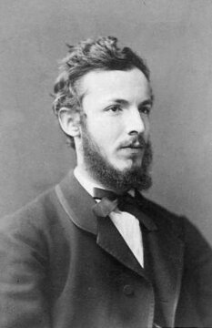
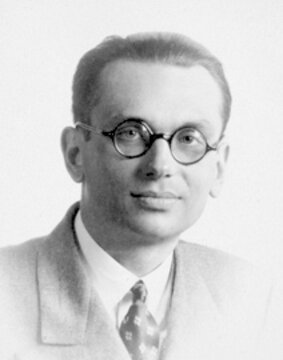

# 1부 — 수학 (5절 논리와 집합론)

  
  
   게오르크 칸토어(1845~1918, 왼쪽)와 쿠르트 괴델(1906~1978, 오른쪽). 사진과 초상: 위키미디어 커먼즈, 퍼블릭 도메인

| # | 문제 | 제기 | 현황 | 해결자/증명자 | 방법 요약 | 검증 상태 | 출처 |
|---|---|---|---|---|---|---|---|
| 1.14 | 연속체 가설 | 게오르크 칸토어, 1878 | ✅ 독립성 증명됨 | 쿠르트 괴델(1940), 폴 코헨(1963) | 괴델은 ZFC에서 연속체 가설을 반증할 수 없음을, 코헨은 강제법(forcing)으로 ZFC에서 증명할 수도 없음을 보였다. 즉 표준 공리계 안에서는 참/거짓을 가릴 수 없다는 것이 증명된 결과다 | 수학계에 널리 받아들여짐. 다만 연속체 가설 자체가 "참인가 거짓인가"는 ZFC를 넘어서는 새 공리 체계(예: 휴 우딘의 연구) 안에서 여전히 논의 중이다 | — |
| 1.23 | 괴델의 불완전성 정리 | 다비트 힐베르트의 형식주의 프로그램(1920년대)에 대한 응답 | ✅ 증명됨 | 쿠르트 괴델, 1931 | 산술을 표현할 수 있을 만큼 강력한 모든 무모순 형식체계에는, 그 체계 안에서 증명할 수도 반증할 수도 없는 참인 명제가 반드시 존재한다는 것(제1정리)과, 그런 체계는 자신의 무모순성을 스스로 증명할 수 없다는 것(제2정리)을 보였다 | 20세기 수학기초론의 가장 널리 받아들여진 결과 중 하나다. [2부 전산학](../part2/02-computability-and-logic.md)의 정지 문제, 결정 문제와 뿌리가 같다 | — |

## 더 깊이 알아보기

### 1.14 연속체 가설

게오르크 칸토어는 무한에도 크기가 다른 여러 단계가 있다는 것을 발견한 사람이다. 1878년 그는 자연수의 무한(가장 작은 무한)과 실수의 무한(그보다 큰 무한) 사이에 중간 크기의 무한이 있는지 없는지를 묻는 연속체 가설을 제기했다. 그는 이 가설을 증명하려고 평생 매달렸지만 끝내 답을 찾지 못했다. 1900년 다비트 힐베르트는 20세기가 풀어야 할 23개 문제 목록의 맨 앞자리에 이 문제를 놓았다. 답은 뜻밖의 방향에서 나왔다. 1940년 쿠르트 괴델은 표준 공리계(ZFC) 안에서 이 가설을 반증할 수 없음을 보였고, 1963년 폴 코헨은 "강제법(forcing)"이라는 완전히 새로운 기법을 발명해 증명할 수도 없음을 보였다. 즉 연속체 가설은 참도 거짓도 아니라, 기존 공리계로는 아예 판가름 낼 수 없는 질문이었던 것이다. 코헨은 이 업적으로 1966년 필즈상을 받았는데, 논리학과 집합론 기초 연구로 필즈상이 수여된 몇 안 되는 사례 중 하나다.

### 1.23 괴델의 불완전성 정리

1930년 쾨니히스베르크에서 열린 한 학술회의, 세션이 거의 끝나갈 무렵 25세의 무명 연구자 쿠르트 괴델이 토론 시간에 조용히 자신의 결과를 언급했다. 청중 대부분은 그 발언의 무게를 눈치채지 못했지만, 그 자리에 있던 존 폰 노이만만은 즉시 그 의미를 알아챘다고 전해진다. 당시 수학계는 다비트 힐베르트가 이끄는 형식주의 프로그램의 영향 아래 있었다. 모든 수학을 유한한 규칙과 공리로 환원해, 그 체계가 무모순이며 모든 참인 명제를 증명할 수 있다는 것을 보이려는 야심 찬 기획이었다. 괴델의 정리는 그 꿈 자체가 원리적으로 불가능하다는 것을 증명해 버렸다. 산술을 표현할 수 있는 어떤 무모순 체계도 자기 안에서 참과 거짓을 가릴 수 없는 명제를 반드시 갖고, 심지어 자신의 무모순성조차 스스로 증명할 수 없다는 것이다. 폰 노이만은 훗날 제2정리를 독자적으로 재발견했지만, 괴델이 이미 증명했다는 것을 알고는 미련 없이 우선권을 양보했다.
