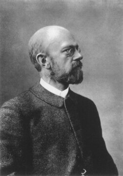
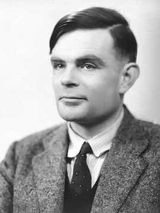

# 2부 — 전산학과 계산 이론 (2절 계산 가능성)

답이 "불가능하다"로 증명된 경우도 이 아카이브에서는 해결(✅)로 분류한다. 불가능성의 증명도 증명이다.

  
  
   다비트 힐베르트(1862~1943, 왼쪽, 1907년 촬영)와 앨런 튜링(1912~1954, 오른쪽, 1951년 촬영). 힐베르트가 1928년 제기한 결정 문제를 튜링이 1936년 풀었다. 사진: 위키미디어 커먼즈, 퍼블릭 도메인

| # | 문제 | 제기 | 현황 | 해결자/증명자 | 방법 요약 | 검증 상태 | 출처 |
|---|---|---|---|---|---|---|---|
| 2.3 | 정지 문제 | 앨런 튜링, 1936 | ✅ 해결(불가능성 증명) | 앨런 튜링 | 임의의 프로그램이 멈출지 멈추지 않을지를 일반적으로 판별하는 알고리즘은 존재할 수 없음을 대각선 논법으로 증명 | 전산학 전체가 이 결과를 기초로 삼는다 | — |
| 2.4 | 결정 문제(Entscheidungsproblem) | 다비트 힐베르트, 1928 | ✅ 해결(불가능성 증명) | 알론조 처치, 앨런 튜링, 1936 (각자 독립적으로) | 1차 논리 명제의 참/거짓을 일반적으로 판별하는 알고리즘이 존재하지 않음을 증명. 정지 문제와 긴밀히 연결된다 | 두 사람의 증명 방식(람다 계산법, 튜링 기계)이 서로 동등함이 이후 밝혀졌다 | — |
| 2.9 | 바쁜 비버 함수 | 티보르 라도, 1962 | 🟡 부분진행 | 바쁜 비버 챌린지 공동 프로젝트, 2024 (BB(5) 확정) | 바쁜 비버 함수 BB(n)은 n개 상태를 가진 튜링 기계 중 멈추는 것이 가장 오래 걸리는 기계의 실행 단계 수다. 함수 자체는 계산 불가능하지만, 작은 n에 대한 구체적인 값은 구할 수 있다. 1989년 마르크센과 분트록이 찾은 기계가 47,176,870단계에서 멈춘다는 것을 바쁜 비버 챌린지 프로젝트가 2024년 7월 Coq(Rocq)으로 약 4만 줄의 형식 증명을 완성해 BB(5)=47,176,870임을 확정했다 | 형식 검증 완료. 40년 넘게 멈춰 있던 값에 새로 확정된 것이다. BB(6)은 여전히 미해결이다 | — |
| 2.10 | 로그-랭크 추측 | 러슬로 로바스, 마이클 색스, 1988 | ✅ 반증됨 | 아르카데브 차토파댜이, 니킬 만데, 수하일 셰리프, 2018~2019 | 통신 복잡도가 (근사) 행렬 랭크의 로그에 다항식으로 비례한다는 추측에 대해, "싱크(sink)" 함수라는 반례를 구성해 지수적 차이가 있음을 증명 | 2019년 STOC 발표, 2020년 Journal of the ACM 게재. 뒤이어 양자 버전의 로그-근사랭크 추측도 반증됐다 | — |

## 더 깊이 알아보기

### 2.3 정지 문제

1936년, 케임브리지를 갓 졸업한 24세의 앨런 튜링은 "계산 가능한 수에 대하여"라는 논문에서 지금 우리가 "컴퓨터"라 부르는 개념의 수학적 원형, 튜링 기계를 처음 제시했다. 그리고 그 틀 안에서, 임의의 프로그램이 멈출지 영원히 돌지를 미리 판별하는 만능 알고리즘은 존재할 수 없다는 것을 증명했다. 증명 방법은 게오르크 칸토어가 무한의 크기를 비교할 때 썼던 대각선 논법을 빌려 온 것이었다. 이 결과는 단순한 수학적 호기심에 그치지 않았다. "컴퓨터로 원리적으로 풀 수 없는 문제가 있다"는 사실 자체가, 이후 모든 전산학의 밑바탕이 됐다.

### 2.4 결정 문제(Entscheidungsproblem)

1928년 다비트 힐베르트는 "모든 수학 명제의 참, 거짓을 기계적으로 판별하는 절차가 있는가"라는 질문을 던지며, 그런 절차가 분명 존재할 것이라 낙관했다. 답은 8년 뒤, 대서양을 사이에 둔 두 젊은 연구자에게서 각각 독립적으로 날아왔다. 프린스턴의 알론조 처치는 람다 계산법이라는 자신만의 체계로, 케임브리지의 앨런 튜링은 튜링 기계라는 전혀 다른 체계로, 거의 동시에 그런 절차는 존재할 수 없다는 것을 증명했다. 두 사람의 접근법은 겉보기에는 완전히 달랐지만, 훗날 수학적으로 완전히 동등하다는 것이 밝혀졌다. 이 우연한 일치는 "계산 가능하다"는 개념 자체가 특정 모델에 의존하는 게 아니라 더 근본적인 무언가라는 것을 암시했고, 이는 오늘날 "처치-튜링 명제"로 불린다.

### 2.9 바쁜 비버 함수

1989년 독일의 하이너 마르크센과 위르겐 분트록은 5개 상태를 가진 튜링 기계 중 47,176,870단계를 돌고서야 멈추는 기계를 찾아냈다. 문제는 이게 정말 "가장 오래 버티는" 기계인지 아무도 확신할 수 없었다는 것이다. 바쁜 비버 함수는 정의상 계산 불가능한 함수라서, 이론적으로는 이 값이 영원히 미해결로 남을 수도 있었다. 2022년, bbchallenge.org라는 온라인 공동 프로젝트가 결성돼 전 세계 자원봉사자들이 가능한 5상태 기계 약 1,000만 개를 하나하나 분류하는 작업에 뛰어들었다. 2024년 7월, 이들은 약 4만 줄에 이르는 Coq(Rocq) 형식 증명을 완성해 BB(5)=47,176,870임을 못 박았다. 35년 만에 확정된 이 값은, 아마추어와 자원봉사자가 모여 공식 논문 없이도 엄밀한 수학적 결과를 만들어 낼 수 있다는 것을 보여 준 사례로 남았다. BB(6)은 여전히 아무도 모른다.

### 2.10 로그-랭크 추측

1988년 러슬로 로바스와 마이클 색스가 제기한 이 추측은, 이후 30년 동안 통신 복잡도 이론에서 가장 유명한 미해결 문제로 꼽혔다. 두 사람이 떨어진 위치에서 정보를 주고받으며 문제를 푸는 데 필요한 통신량이, 그 문제를 나타내는 행렬의 (근사) 랭크의 로그 값 정도에 그친다는 내용이었다. 2018년 아르카데브 차토파댜이, 니킬 만데, 수하일 셰리프는 "싱크(sink)" 함수라는 교묘한 반례를 구성해 이 추측이 거짓임을 보였다. 30년 동안 참이라고 널리 믿어졌던 추측이 반례 하나로 무너진 셈이다. 뒤이어 다른 연구팀들이 양자 버전의 비슷한 추측도 같은 방식으로 반증하면서, 통신 복잡도 이론의 오래된 믿음 하나가 통째로 뒤집혔다.
