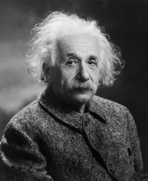

# 3부 — 물리학 (1절 입자와 장)

물리학의 난제는 수학과 다르다. 증명이 아니라 관측과 실험으로 결론이 난다. 그래서 "해결"은 이론이 예측하고 실험이 확인하는 쌍이 맞아야 성립한다. 번호는 3부 전체에서 공통으로 쓰는 고유 번호다.

  
   알베르트 아인슈타인(1879~1955, 1947년 촬영). 일반상대성이론을 완성했지만, 그 이론을 양자역학과 하나로 묶는 양자 중력 이론은 아직 아무도 완성하지 못했다. 사진: 위키미디어 커먼즈, 퍼블릭 도메인

| # | 문제 | 제기 | 현황 | 해결자/증명자 | 방법 요약 | 검증 상태 | 출처 |
|---|---|---|---|---|---|---|---|
| 3.1 | 양자 중력 이론 | 1930년대부터 제기 | ⏳ 미해결 | — | 일반상대성이론(거시적 중력)과 양자역학(미시적 입자)을 하나의 틀로 통합하는 이론이 아직 없다. 끈이론, 루프 양자중력 등 후보는 여럿이지만 실험으로 검증된 것은 없다 | — | — |
| 3.2 | 양-밀스 질량 간극 | 클레이수학연구소, 2000 | ⏳ 미해결 | — | [1부 수학](../part1/04-analysis-pde.md) 1.3과 같은 문제. 입자물리학 표준모형이 실험적으로는 질량 간극을 전제하지만, 수학적으로 엄밀한 증명은 없다 | — | — |
| 3.6 | 계층성 문제 | 1970년대 입자물리학 | ⏳ 미해결 | — | 힉스 입자의 질량이 양자보정을 감안하면 플랑크 스케일에 가까워야 할 것 같은데 실제로는 왜 훨씬 작은지를 묻는다 | — | — |
| 3.10 | 강한 CP 문제 | 로베르토 페체이, 헬렌 퀸 등, 1970년대 | ⏳ 미해결 | — | 양자색역학(QCD)의 방정식에는 CP 대칭(입자-반입자 반전과 좌우 반전을 동시에 했을 때의 대칭)을 깨는 항이 허용되는데, 실험으로 관측되는 깨짐은 극단적으로 작다. 왜 그렇게 작은지 설명이 없다 | — | — |
| 3.11 | 힉스 메커니즘의 존재 | 피터 힉스 등, 1964 | ✅ 해결 | CERN 거대강입자가속기(LHC)의 ATLAS, CMS 실험팀, 2012 | 입자에 질량을 부여하는 힉스 장과 힉스 보손의 존재를 예측한 지 48년 만에 실제로 입자를 검출 | 2012년 7월 발표, 2013년 노벨물리학상(피터 힉스, 프랑수아 앙글레르) 수여. 이후 여러 실험에서 반복 확인됨 | — |
| 3.12 | 중성미자의 절대 질량 | 중성미자 질량 자체는 1998년 중성미자 진동 발견으로 확인 | ⏳ 미해결 | — | 중성미자가 질량을 갖는다는 것은 확인됐지만(진동 현상으로), 그 절대적인 질량값과 세 종류 중성미자의 질량 순서(질량 계층구조)는 아직 측정되지 않았다 | — | — |

## 더 깊이 알아보기

### 3.1 양자 중력 이론

일반상대성이론을 완성한 뒤, 알베르트 아인슈타인은 남은 생애 30년을 중력과 전자기력을 하나로 묶는 "통일장 이론"을 찾는 데 쏟았다. 프린스턴 고등연구소의 자기 사무실에 틀어박혀 혼자 연구를 이어 갔지만, 그사이 물리학의 주류는 그가 끝까지 받아들이지 못했던 양자역학 쪽으로 옮겨 갔다. 1955년 세상을 떠날 때까지 그는 답을 찾지 못했다. 그가 풀려던 문제는 오늘날 더 어려운 형태로 남아 있다. 거시적 중력을 설명하는 일반상대성이론과 미시적 입자를 설명하는 양자역학을 하나로 합치는 일은, 끈이론과 루프 양자중력 같은 후보 이론이 반세기 넘게 경쟁하고 있지만 실험으로 검증할 방법조차 아직 뚜렷하지 않다.

### 3.2 양-밀스 질량 간극

[1부 1.3](../part1/04-analysis-pde.md)에서 수학적 증명의 관점을 다뤘다면, 물리학 쪽 이야기는 조금 다르다. 1954년 처음 나왔을 때 "질량이 없는 입자를 예측하는데 그런 입자는 관측된 적이 없다"는 이유로 비현실적인 이론 취급을 받았던 양-밀스 장이론은, 자발적 대칭 깨짐이라는 개념이 더해지면서 반전됐다. 오늘날 이 이론은 강력과 약력을 설명하는 표준모형의 핵심 엔진으로 매일 입자가속기 실험에 쓰인다. 물리학자 입장에서 이 이론은 이미 충분히 검증된 "사실"이나 다름없지만, 수학자 입장에서는 그 엄밀한 기초조차 아직 증명되지 않은 가설이다. 같은 이론을 보는 두 분야의 온도 차이가 이보다 극명하게 드러나는 경우도 드물다.

### 3.6 계층성 문제

왜 중력은 다른 세 힘(전자기력, 강력, 약력)보다 10의 36제곱 배나 약할까. 1970년대부터 제기된 이 질문에 가장 유력하게 꼽히던 답은 초대칭이론이었다. 알려진 모든 입자에 짝이 되는 "초대칭 입자"가 존재해 양자보정 효과를 상쇄한다는 설명이었다. 물리학자들은 2010년대 들어 가동된 거대강입자가속기(LHC)가 이 초대칭 입자를 찾아낼 것이라 자신했다. 그러나 수년간의 충돌 실험에서도 흔적조차 나오지 않았고, 일부 물리학자는 이를 입자물리학의 "악몽 시나리오"라 부르며 공개적으로 실망감을 드러냈다. 초대칭이 힘을 잃자, 우리가 느끼지 못하는 숨겨진 여분 차원으로 중력이 새어 나간다는 또 다른 가설이 대안으로 떠올랐지만, 역시 확인된 바는 없다.

### 3.10 강한 CP 문제

양자색역학의 방정식에는 입자와 반입자, 좌우를 동시에 뒤집는 CP 대칭을 깰 수 있는 항이 수학적으로 허용된다. 그런데 중성자의 전기쌍극자모멘트를 정밀하게 측정한 실험에서는 그 깨짐의 크기가 사실상 0에 가까울 만큼 작게 나왔다. 왜 자연은 수학적으로 허용된 선택지를 쓰지 않았을까. 1977년 로베르토 페체이와 헬렌 퀸은 이 수수께끼를 풀 메커니즘을 제안하면서, 그 과정에서 "액시온"이라는 가상의 입자가 존재해야 한다는 결론에 이르렀다. 흥미롭게도 이 액시온은 암흑물질의 유력한 후보로도 꼽히게 됐다. 전 세계 여러 실험실이 수십 년째 액시온 검출기를 돌리고 있지만, 아직 단 하나도 발견되지 않았다.

### 3.11 힉스 메커니즘의 존재

1964년, 피터 힉스를 포함해 여러 연구팀이 거의 동시에 비슷한 아이디어를 유럽 학술지에 투고했다. 공교롭게도 힉스의 첫 논문은 한 차례 게재를 거절당했는데, 그는 논문에 새로운 입자의 존재를 암시하는 문장 한 줄을 추가해 다른 학술지에 다시 투고했고, 그 문장이 훗날 "힉스 보손"이라는 이름으로 불리는 입자의 예언이 됐다. 예측이 나온 지 48년이 지난 2012년 7월, CERN은 거대강입자가속기 실험으로 이 입자를 실제로 검출했다고 발표했다. 발표 현장에는 당시 83세였던 피터 힉스도 있었는데, 자신의 이름이 붙은 입자가 발견됐다는 소식에 눈물을 보이는 모습이 카메라에 담겨 전 세계로 퍼졌다.

### 3.12 중성미자의 절대 질량

1998년까지만 해도 표준모형은 중성미자가 질량이 없다고 가정했다. 그해 일본 슈퍼카미오칸데 실험이 중성미자가 종류를 바꾸며 진동하는 현상을 관측했는데, 이 현상은 중성미자가 질량을 가져야만 설명될 수 있었다. 이 발견은 표준모형의 기본 가정 하나를 뒤집은 사건이었고, 2015년 노벨물리학상으로 이어졌다. 그런데 진동 실험은 세 종류 중성미자 사이의 질량 "차이"만 알려 줄 뿐, 각각의 절대적인 질량값은 알려 주지 못한다. 독일의 KATRIN 실험을 비롯한 여러 연구팀이 그 절대값을 재려고 애쓰고 있지만, 아직 확정된 숫자는 나오지 않았다.
