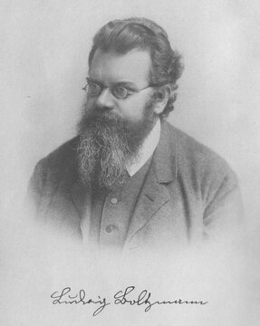

# 3부 — 물리학 (3절 기초와 거시 현상)

  
   루트비히 볼츠만(1844~1906). 통계역학으로 엔트로피를 정의했지만, 왜 시간이 한 방향으로만 흐르는지는 그 자신도 완전히 풀지 못했다. 사진: 위키미디어 커먼즈, 퍼블릭 도메인

| # | 문제 | 제기 | 현황 | 해결자/증명자 | 방법 요약 | 검증 상태 | 출처 |
|---|---|---|---|---|---|---|---|
| 3.5 | 양자역학의 측정 문제 | 1920년대 코펜하겐 해석 논쟁 이후 | ⏳ 미해결 | — | 파동함수가 관측 시점에 왜, 어떻게 하나의 상태로 "붕괴"하는지를 묻는다. 코펜하겐 해석, 다세계 해석, 드브로이-봄 해석 등이 경쟁하지만 실험으로 구분할 방법이 아직 없다 | — | — |
| 3.7 | 시간의 방향(시간의 화살) | 루트비히 볼츠만의 통계역학, 19세기 | ⏳ 미해결 | — | 물리 법칙 대부분은 시간에 대해 대칭인데, 열역학 제2법칙은 왜 한 방향으로만 흐르는지를 묻는다. 초기 우주의 낮은 엔트로피 상태가 원인으로 꼽히지만 왜 그런 초기조건이었는지는 설명하지 못한다 | — | — |
| 3.9 | 핵융합의 상용화 | 1950년대부터 연구 | 🟡 부분진행 | — | 핵융합 반응 자체의 물리적 원리는 이미 알려져 있다. 문제는 경제성 있는 발전으로 만드는 공학이다. ITER 등 대형 실험로가 진행 중이지만 상용 발전은 아직 없다. 과학적 난제가 아니라 공학적 난제에 가깝다 | — | [확인 필요: 2026년 기준 ITER 및 민간 핵융합 스타트업 진행 상황] |
| 3.16 | 난류의 완전한 이론 | 레오나르도 다빈치의 관찰(15세기)부터, 현대적 정식화는 19~20세기 유체역학 | ⏳ 미해결 | — | 유체가 불규칙하게 소용돌이치는 난류 현상을 예측하는 완전한 이론이 없다. [1부 수학](../part1/04-analysis-pde.md) 1.4(나비어-스토크스 방정식)의 해의 존재와 매끄러움 문제와 깊이 연결돼 있다. 리처드 파인만이 "고전물리학에서 가장 중요한 미해결 문제"라고 부른 바 있다 | — | — |

## 다른 부와 겹치는 문제

생명의 의식이 물리적 과정으로 완전히 설명되는지는 [5부 신경과학과 심리학](../part5/01-consciousness-and-brain.md)과 [6부 철학](../part6/01-mind-and-knowledge.md)에서 다룬다.

## 더 깊이 알아보기

### 3.5 양자역학의 측정 문제

1935년 에르빈 슈뢰딩거는 상자 안에 든 고양이가 살아 있으면서 동시에 죽어 있는 상태로 놓인다는 사고실험을 제시했다. 흥미로운 것은, 슈뢰딩거가 이 비유를 내놓은 의도가 코펜하겐 해석을 지지하려는 게 아니라 정반대였다는 점이다. 그는 미시 세계의 중첩 상태를 거시 세계의 고양이에게까지 그대로 적용하면 이렇게 터무니없는 결론에 이른다는 것을 보여 주며, 당시 널리 받아들여지던 해석을 비꼬려 했다. 오늘날에는 오히려 이 비유가 양자 중첩을 "증명"하는 사례처럼 대중에게 알려져 있는데, 정작 슈뢰딩거 본인의 의도와는 정반대인 셈이다. 같은 해 아인슈타인, 포돌스키, 로젠도 양자역학의 완전성에 의문을 제기하는 논문을 발표하며 논쟁에 불을 지폈다. 90년이 지난 지금도 파동함수가 왜, 어떻게 하나의 상태로 "붕괴"하는지는 여러 해석이 팽팽히 맞설 뿐 실험으로 가려지지 않았다.

### 3.7 시간의 방향

루트비히 볼츠만은 평생 자신의 통계역학 이론을 둘러싼 격렬한 반대에 시달렸다. 당대 영향력 있던 물리학자 에른스트 마흐와 빌헬름 오스트발트는 원자의 존재 자체를 받아들이지 않았고, 원자를 전제로 한 볼츠만의 이론을 공개적으로 비판했다. 거듭된 논쟁과 우울증에 시달리던 볼츠만은 1906년 스스로 생을 마감했다. 그가 세상을 떠나고 불과 몇 년 뒤, 아인슈타인의 브라운 운동 논문과 장 페랭의 실험이 원자의 실재를 입증하면서 볼츠만의 이론은 완전히 복권됐다. 정작 그는 자신이 옳았다는 것을 확인받지 못하고 떠난 셈이다. 그가 남긴 엔트로피 개념은 지금도 "왜 시간은 한 방향으로만 흐르는가"라는 질문의 출발점으로 쓰이지만, 우주 초기에 왜 엔트로피가 그렇게 낮았는지는 여전히 풀리지 않았다.

### 3.9 핵융합의 상용화

"핵융합 발전은 늘 30년 뒤에 있다"는 농담은 1950년대부터 물리학계에 떠돌았다. 소련의 이고르 탐과 안드레이 사하로프가 토카막 개념을 제안한 이래, 국제 공동 프로젝트 ITER가 프랑스에 건설되는 지금까지도 상용 발전까지는 갈 길이 멀다. 그래도 최근에는 실질적인 이정표가 나왔다. 2022년 12월, 미국 국립점화시설(NIF)은 레이저로 가둔 핵융합 반응에서 투입한 에너지보다 더 많은 에너지를 뽑아내는 "점화"에 처음으로 성공했다고 발표했다. 핵융합 자체의 물리적 원리는 태양이 매 순간 증명하고 있으니 의심할 여지가 없다. 남은 것은 이를 경제성 있는 발전으로 만드는 공학의 문제다.

### 3.16 난류의 완전한 이론

레오나르도 다빈치는 1500년대 초, 물이 바위에 부딪혀 소용돌이치는 모습을 스케치로 남기며 그 불규칙한 패턴을 세심하게 관찰했다. 수학적으로 설명할 방법이 전혀 없던 시절에도 난류의 복잡함은 이미 눈에 보일 만큼 또렷했던 셈이다. 그로부터 500년이 지났지만, 리처드 파인만이 "고전물리학에서 가장 중요한 미해결 문제"라 불렀을 만큼 난류는 여전히 완전한 이론이 없다. [1부 1.4](../part1/04-analysis-pde.md) 나비어-스토크스 방정식의 해가 항상 매끈하게 유지되는지를 묻는 문제와 깊이 얽혀 있어서, 순수 수학과 공학 양쪽에서 동시에 풀리기를 기다리는 드문 문제이기도 하다.
