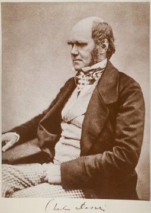

# 4부 — 생로병사: 생물학과 의학 (2절 질병과 생명의 기원)

사용자가 요청한 "암" 난제가 이 절에 있다.

먼저 분명히 해 둘 것이 있다. **암은 하나의 병이 아니다.** 발생 부위와 원인 유전자 변이에 따라 수백 종으로 나뉘는 질병군이다. 그래서 "암을 정복했다"는 식의 단일 선언은 성립하지 않는다. 이 아카이브는 그런 과장을 본문에 넣지 않는다. 대신 어떤 암종에서 어떤 치료가 왜 효과가 있었는지를 구체적으로 적는다.

| # | 문제 | 제기 | 현황 | 해결자/증명자 | 방법 요약 | 검증 상태 | 출처 |
|---|---|---|---|---|---|---|---|
| 4.3 | 암의 완전한 정복 | 현대 의학 전반의 과제 | 🟡 부분진행(질병군마다 다름) | 제임스 앨리슨, 혼조 다스쿠 (면역관문억제제 이론, 2018 노벨생리의학상) 외 다수 | 면역관문억제제(CTLA-4, PD-1 차단)와 CAR-T 세포치료(칼 준 등, 2017년 FDA 승인) 등은 특정 암종(흑색종, 일부 혈액암 등)에서 생존율을 크게 끌어올렸다. 그러나 암을 포괄하는 단일 치료법은 존재하지 않는다 | 각 치료법은 개별 임상시험과 FDA 등 규제기관 승인으로 검증됨. "암 정복"이라는 전체 명제 자체는 검증 대상이 아니다(애초에 그런 단일 질병이 없다) | — |
| 4.4 | 생명의 기원(비생명에서 생명으로) | 현대 생화학, 1950년대 밀러-유리 실험 이후 본격화 | ⏳ 미해결 | — | 간단한 유기분자가 원시 지구 조건에서 합성될 수 있다는 것은 실험으로 보였으나(스탠리 밀러, 해럴드 유리, 1953), 자기복제하는 최초의 생명체가 어떻게 등장했는지는 여러 가설(RNA 세계설 등) 수준에 머물러 있다 | — | — |
| 4.5 | 단백질 구조 예측 문제 | 아미노산 서열에서 입체 구조를 알아내는 문제, 1960년대부터 제기(레빈탈의 역설) | 🟡 부분해결(핵심 하위문제는 해결 수준) | 존 점퍼, 데미스 허사비스 외 딥마인드 알파폴드 팀, 2020~2021 | 딥러닝으로 아미노산 서열만으로 3차원 구조를 예측하는 알파폴드2를 개발. 2020년 CASP14 대회에서 실험 수준에 근접한 정확도를 달성 | 2021년 Nature 논문 발표, 이후 수십만 개 구조가 공개 데이터베이스로 검증 가능한 형태로 제공됨. 2024년 노벨화학상(존 점퍼, 데미스 허사비스, 데이비드 베이커) 수여. 다만 "구조 예측"과 "접힘 과정(동역학) 자체의 완전한 이해"는 다른 문제이며, 후자는 여전히 미해결로 남는다. 자세한 것은 [8부 8.1](../part8/01-early-cases.md) 참고 | — |
| 4.6 | 알츠하이머병 등 신경퇴행성질환의 근본 원인과 치료 | 현대 신경과학 전반 | ⏳ 미해결 | — | 아밀로이드 베타 축적을 원인으로 보는 "아밀로이드 가설"이 오랫동안 주류였으나 치료 성과가 기대에 못 미쳐 재검토되는 중이다. 레카네맙 등 항체 치료제가 일부 지표를 개선했다는 임상 결과가 있으나 근치는 아니다 | — | [확인 필요: 아밀로이드 가설 관련 2026년 기준 최신 학계 동향] |
| 4.10 | 자가면역질환의 원인 | 현대 면역학 전반 | ⏳ 미해결 | — | 면역계가 왜 특정 사람에게서 자기 조직을 공격하는 쪽으로 돌아서는지, 유전과 환경(감염, 미생물 노출 등)이 각각 얼마나 기여하는지에 대한 통합된 설명이 없다. 류머티즘관절염, 1형 당뇨, 루푸스 등 질환마다 원인 가설이 다르다 | — | — |
| 4.11 | 비만과 대사질환의 근본 기전 | 현대 내분비학과 대사질환 연구 전반 | ⏳ 미해결 | — | 체중 설정값(set point)을 조절하는 뇌와 호르몬의 상호작용, 개인마다 다른 비만 취약성의 유전적 요인과 환경적 요인에 대한 통합 이론이 없다. GLP-1 계열 약물(세마글루타이드 등)이 체중 감량에 큰 효과를 보였지만, 이는 치료 수단이지 기전 전체를 설명하는 이론은 아니다 | — | — |
| 4.12 | 장내 미생물과 질병의 인과관계 | 2000년대 이후 마이크로바이옴 연구 확산 | ⏳ 미해결 | — | 장내 미생물 구성이 비만, 자가면역질환, 우울증 등 여러 질환과 상관관계를 보인다는 연구는 많지만, 미생물 구성이 질병의 원인인지 결과인지를 가르는 인과관계는 대부분 확립되지 않았다 | — | — |
| 4.13 | 유성생식의 진화적 이득 | 존 메이너드 스미스, 1978 『성의 진화』에서 "진화생물학의 여왕 문제"로 명명 | ⏳ 미해결 | — | 무성생식은 자손 수를 이론적으로 두 배 빨리 늘릴 수 있는데도("유성생식의 두 배 비용"), 왜 대부분의 진핵생물이 번식 비용이 큰 유성생식을 유지하는지를 묻는다. 기생생물과의 공진화에서 유전적 다양성이 유리하다는 붉은 여왕 가설, 해로운 돌연변이를 효율적으로 솎아낸다는 뮐러의 톱니바퀴 회피 가설 등이 있지만 어느 요인이 결정적인지 합의가 없다 | — | — |
| 4.14 | 진화 이론의 확장 논쟁 | 케빈 랠런드 등이 2014년 Nature에 공개 논쟁으로 제기 | ⏳ 미해결(이론 틀에 대한 논쟁) | — | 돌연변이, 자연선택, 유전적 부동, 유전자 흐름을 중심으로 한 20세기 중반의 "현대적 종합"에, 발생적 가소성, 생태적 지위 구축, 후성유전적 유전 같은 메커니즘을 이론의 핵심 요소로 추가해야 하는지를 둘러싼 논쟁. 생물학계 내부에서 전통적 틀을 지지하는 쪽과 확장이 필요하다고 보는 쪽이 나뉜다 | 진화가 일어난다는 사실이나 자연선택이 실재한다는 것 자체는 생물학계 안에서 논쟁 대상이 아니다. 유전학, 화석 기록, 관찰된 종 분화, 분자생물학이 독립적으로 같은 결론을 뒷받침한다. 이 항목이 다루는 논쟁은 "그 메커니즘을 어떤 틀로 설명할지"에 관한 것이지, "진화가 일어나는지"가 아니다 | [확인 필요: 2026년 기준 논쟁의 최신 흐름] |

  
   찰스 다윈(1809~1882). 1859년 『종의 기원』에서 자연선택에 의한 진화를 제시했다. 사진: 위키미디어 커먼즈, 퍼블릭 도메인

## 왜 "진화가 증명됐는가"는 난제로 싣지 않았는가

이 아카이브는 검증 기준이 분명한 과학적 주장과, 검증 기준이 아예 없는 철학적 질문과 종교적 질문을 구분해서 다룬다([부록 B](../appendix/b-legend.md)). 생명이 공통 조상에서 갈라져 나왔고 자연선택이 그 과정의 주요 동력이라는 것은, 수학의 정리처럼 "증명"되는 것이 아니라 과학의 다른 모든 이론(중력 이론, 세균설 등)과 같은 방식으로 "뒷받침"된다. 화석 기록, 비교해부학, 분자유전학, 실험실과 자연에서 직접 관찰된 종 분화가 독립적으로 같은 결론을 가리키고, 이를 뒤집는 반증 사례는 150년 넘게 나온 적이 없다. 그래서 이 항목은 생물학계 안에서 "미해결"로 분류되지 않는다.

반대로 4.13과 4.14처럼 진화가 **어떤 메커니즘으로, 어느 정도의 비중으로** 일어나는지에 대해서는 생물학자들 사이에서도 실제로 논쟁이 있다. 이 아카이브는 그 진짜 논쟁을 숨기지 않고 싣는다.

## 참여하려면

의학 분야는 특히 임상적 근거 수준이 중요하다. [부록 A](../appendix/a-registration.md)에 따라 동료 심사를 통과한 무작위 대조 임상시험이나 이에 준하는 근거 없이는 상태를 ✅나 🟡로 올리지 않는다.

## 더 깊이 알아보기

### 4.3 암의 완전한 정복

제임스 앨리슨은 어린 시절 어머니를 림프종으로 잃었다. 그 경험이 평생 면역학에 매달리게 된 계기였다고 그는 여러 인터뷰에서 밝혔다. 그가 찾아낸 CTLA-4 차단 메커니즘은 수년 동안 제약회사들의 투자를 거절당했다. 면역계를 건드려 암을 공격하게 만든다는 발상이 당시로서는 너무 위험하고 비현실적으로 보였기 때문이다. 끈질긴 설득 끝에 결국 치료제(여보이)가 개발됐고, 혼조 다스쿠가 독자적으로 찾아낸 PD-1 메커니즘과 함께 2018년 노벨생리의학상을 받았다. 한편 CAR-T 세포치료를 개척한 칼 준은 아내를 난소암으로 떠나보낸 뒤 면역치료 연구에 뛰어들었다. 2012년, 백혈병으로 죽음 문턱까지 갔던 6세 소녀 에밀리 화이트헤드가 그의 CAR-T 치료를 받고 극적으로 회복해 완치 판정을 받았고, 이 사례는 세포치료 시대를 상징하는 이야기로 지금도 자주 인용된다. 두 접근 모두 특정 암종에서는 생존율을 크게 끌어올렸지만, 암이라는 수백 가지 질병군 전체를 한 번에 잠재울 치료법은 여전히 없다.

### 4.4 생명의 기원

1953년, 시카고대 대학원생이던 스물세 살의 스탠리 밀러는 지도교수 해럴드 유리에게 원시 지구를 흉내 낸 실험을 해 보자고 제안했다. 유리는 큰 기대를 걸지 않았지만 해 보도록 허락했다. 물, 메탄, 암모니아, 수소를 채운 유리 플라스크에 번개를 흉내 낸 전기 방전을 일주일 동안 흘려보내자, 놀랍게도 아미노산이 만들어졌다. 생명의 재료가 원시 지구 조건에서 저절로 합성될 수 있다는 것을 보여 준 이 실험은 즉각 세계적인 화제가 됐다. 2008년, 밀러가 보관해 뒀던 당시 실험 시료를 현대적인 분석 기법으로 다시 조사한 연구팀은 원래 보고된 것보다 훨씬 다양한 아미노산이 그 안에 들어 있었다는 것을 발견하기도 했다. 다만 이 실험이 보여 준 것은 생명의 "재료"가 만들어질 수 있다는 것일 뿐, 그 재료가 어떻게 스스로 복제하는 최초의 생명체로 조직됐는지는 여전히 가설(RNA 세계설 등) 수준에 머물러 있다.

### 4.5 단백질 구조 예측 문제

1969년 사이러스 레빈탈은 기묘한 역설을 지적했다. 단백질 하나가 접힐 수 있는 모든 경우의 수를 하나하나 따져 보면, 무작위로 최적의 모양을 찾는 데만도 우주의 나이보다 긴 시간이 걸려야 한다는 것이었다. 그런데 실제 단백질은 수백만 분의 1초 만에 정확한 모양으로 접힌다. 1994년부터 2년마다 열린 CASP 대회는 전 세계 연구팀이 단백질 구조 예측 실력을 겨루는 자리였는데, 수십 년 동안 성적은 더디게만 개선됐다. 2020년 CASP14에서 딥마인드의 알파폴드2가 낸 결과는 심사를 맡은 베테랑 구조생물학자들조차 놀랄 정도였다. 예측 정확도가 실험으로 직접 구조를 밝히는 수준에 거의 맞먹었기 때문이다. 오랫동안 "50년 묵은 난제"로 불리던 문제가 사실상 풀렸다는 평가가 나왔고, 2024년 노벨화학상으로 이어졌다.

### 4.6 알츠하이머병 등 신경퇴행성질환의 근본 원인과 치료

1906년 독일의 정신과 의사 알로이스 알츠하이머는 환자 아우구스테 데터의 뇌에서 이상한 반점과 엉킨 섬유를 발견하고 이 병을 처음 기술했다. 그 뒤 한 세기 넘게 "아밀로이드 베타가 쌓여 병을 일으킨다"는 가설이 연구를 주도했다. 그런데 2022년, 과학 전문지 사이언스의 탐사보도는 이 가설의 핵심 근거가 된 2006년 네이처 논문의 이미지에서 조작 의혹이 있는 흔적을 찾아냈다고 보도했다. 해당 논문은 16년 동안 수천 번 인용되며 막대한 연구비가 아밀로이드 중심 연구로 쏠리는 데 영향을 미친 것으로 알려져, 학계에 적잖은 충격을 줬다. 최근 레카네맙 같은 항체 치료제가 임상시험에서 일부 지표 개선을 보였지만, 효과의 크기를 두고도 논쟁이 있고 근치와는 거리가 멀다.

### 4.10 자가면역질환의 원인

1989년 역학자 데이비드 스트라칸은 형제자매가 많은 아이일수록 알레르기성 질환에 덜 걸린다는 통계를 발표하며 "위생 가설"을 제안했다. 어릴 때 다양한 미생물에 노출될수록 면역계가 "정상적으로" 훈련되고, 그렇지 못하면 면역계가 엉뚱한 표적(꽃가루, 심지어 자기 몸의 조직)을 공격하게 된다는 생각이었다. 선진국에서 위생 수준이 올라갈수록 자가면역질환과 알레르기 발병률이 함께 치솟는 현상은 이 가설을 뒷받침하는 정황처럼 보였다. 그러나 정황과 인과관계는 다르다. 류머티즘관절염, 1형 당뇨, 루푸스처럼 서로 다른 질환마다 관여하는 유전자와 환경 요인이 제각각이라, 하나의 통합된 설명으로 묶이지 않는다.

### 4.11 비만과 대사질환의 근본 기전

1994년 록펠러대 제프리 프리드먼 연구팀은 비만한 생쥐에게 부족한 호르몬 렙틴을 발견했다. 렙틴을 주사하자 생쥐는 극적으로 살이 빠졌고, 언론은 즉시 "비만 치료제"의 등장을 예고했다. 그런데 정작 비만인 사람 대부분은 렙틴이 부족한 게 아니라 이미 충분히 많았다. 몸이 렙틴 신호에 반응하지 않는 "렙틴 저항성"이 문제였던 것이다. 기대는 빠르게 식었다. 그로부터 30년 가까이 지나 등장한 GLP-1 계열 약물(세마글루타이드 등)의 뿌리는 더 뜻밖이다. 1990년대 존 엥이 아메리카독도마뱀의 침에서 발견한 호르몬 유사 물질(엑센딘-4)이 그 출발점이었다. 이 약물들이 체중 감량에 큰 효과를 보인다는 것은 확인됐지만, 그 효과가 뇌와 호르몬이 체중을 어떻게 "설정"하는지에 대한 완전한 이론으로 이어지지는 않았다.

### 4.12 장내 미생물과 질병의 인과관계

장내 미생물을 건강한 기증자의 것으로 통째로 이식하는 "대변 미생물 이식"은 클로스트리디움 디피실레균 감염처럼 특정 질환에는 효과가 분명하게 입증돼 있다. 2007년 시작된 인간 마이크로바이옴 프로젝트 이후, 장내 미생물 구성과 비만, 우울증, 자가면역질환 사이의 상관관계를 보고하는 논문이 쏟아졌다. 문제는 상관관계에서 인과관계로 넘어가는 다리가 아직 부실하다는 데 있다. 비만한 사람의 장내 미생물 구성이 비만의 원인인지, 아니면 비만한 몸이 특정 미생물을 선호하는 환경을 만든 결과인지는 질환마다 다르고, 대부분 아직 명확히 가려지지 않았다.

### 4.13 유성생식의 진화적 이득

진화생물학자 존 메이너드 스미스는 1978년 쓴 책에서 이 문제를 "진화생물학의 여왕 문제"라 불렀다. 수학적으로 따지면 무성생식을 하는 개체군은 유성생식을 하는 개체군보다 두 배 빠르게 불어날 수 있다. 그런데도 지구상 거의 모든 복잡한 생명체는 번거롭고 비용이 큰 유성생식을 고수한다. 기생생물과 끊임없는 군비 경쟁을 벌이려면 유전적 다양성이 필요하다는 "붉은 여왕 가설"이 가장 널리 인용되는 설명이지만, 이것이 유일한 답인지는 반세기 가까이 논쟁 중이다.

### 4.14 진화 이론의 확장 논쟁

2014년 Nature는 "진화 이론은 재검토가 필요한가"라는 제목의 지상 논쟁을 실었다. 한쪽에는 발생적 가소성과 생태적 지위 구축 같은 메커니즘을 이론의 핵심에 넣어야 한다고 주장하는 케빈 랠런드 등이, 다른 쪽에는 기존의 현대적 종합으로 충분히 설명된다고 보는 그레고리 레이 등이 섰다. 양쪽 모두 생명이 공통 조상에서 진화했다는 것 자체는 추호도 의심하지 않는 정통 진화생물학자들이었다. 그런데도 이 논쟁은 종종 "과학자들도 진화론을 의심한다"는 식으로 맥락이 잘려 와전되곤 했다. 실제 쟁점은 진화가 일어나는지가 아니라, 기존 이론 틀이 그 메커니즘을 얼마나 충분히 설명하는지였다.
