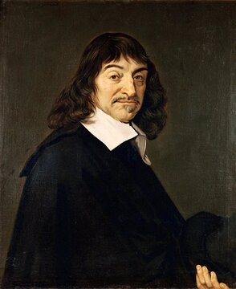

# 6부 — 철학 (1절 마음과 인식론)

철학의 난제는 대부분 "증명"으로 끝나지 않는다. 논증으로 입장을 좁혀 가는 것이지, 수학처럼 닫히지 않는다. 그래서 이 부의 항목은 ❓(해결 기준 자체가 불명확하거나 없음)와 ⏳(해결 기준은 있으나 합의된 답이 없음)로 나눠 표시했다. 번호는 6부 전체에서 공통으로 쓰는 고유 번호다.

  
   르네 데카르트(1596~1650, 프란스 할스가 그린 초상). 1641년 『성찰』에서 심신 이원론을 제시했다. 초상: 위키미디어 커먼즈, 퍼블릭 도메인

| # | 문제 | 제기 | 현황 | 주요 입장 | 비고 |
|---|---|---|---|---|---|
| 6.1 | 심신 문제 | 르네 데카르트의 이원론, 1641년 『성찰』 이후 본격화 | ❓ | 물리주의, 이원론, 기능주의, 범심론 등이 경쟁한다 | [5부](../part5/01-consciousness-and-brain.md) 5.1의 의식의 어려운 문제와 뿌리가 같다 |
| 6.2 | 자유의지와 결정론의 양립 가능성 | 고대부터, 현대적 틀은 18세기 이후 | ❓ | 양립가능론(자유의지와 결정론이 함께 성립할 수 있다), 양립불가능론(둘 중 하나만 가능하다. 자유지상론 또는 강한 결정론) | [5부](../part5/01-consciousness-and-brain.md) 5.3과 연결 |
| 6.4 | 게티어 문제 | 에드먼드 게티어, 1963 | ⏳ | "지식 = 정당화된 참인 믿음"이라는 전통적 정의에 대한 반례를 제시. 이후 다양한 보완안(인과설, 신빙론 등)이 나왔지만 모두를 만족시키는 정의는 아직 없다 | 분석철학에서 가장 자주 인용되는 미해결 문제 중 하나 |
| 6.5 | 귀납의 문제 | 데이비드 흄, 1739 『인간 본성에 관한 논고』 | ⏳ | 과거에 반복해서 일어난 일이 미래에도 일어날 것이라는 믿음을 논리적으로 정당화할 수 없다는 문제. 칼 포퍼의 반증주의 등 여러 대응이 있었지만 흄의 문제를 완전히 해소했다는 합의는 없다 | — |
| 6.8 | 타인의 마음 문제 | 근대 인식론 전반 | ❓ | 나 자신의 의식은 직접 경험하지만, 타인에게도 의식이 있다는 것은 행동과 유사성에 근거한 추론일 뿐 직접 확인할 수 없다는 문제 | [5부](../part5/01-consciousness-and-brain.md) 5.1과 연결 |
| 6.9 | 정당화의 무한 후퇴 문제 | 고대 회의주의, 현대적 정식화는 "아그리파의 트릴레마" | ❓ | 어떤 믿음이 정당화되려면 다른 믿음으로 뒷받침해야 하는데, 그 믿음을 또 뒷받침해야 하는 무한 후퇴에 빠진다. 토대주의(더는 뒷받침이 필요 없는 기초 믿음이 있다), 정합주의(개별 뒷받침이 아니라 전체 믿음 체계의 정합성이 중요하다), 후퇴 수용(무한 후퇴 자체를 받아들인다)이 경쟁한다 | — |
| 6.10 | 인격의 동일성 문제 | 고대의 "테세우스의 배" 역설, 현대적 정식화는 데릭 파핏 등 | ❓ | 어제의 나와 오늘의 나를 "같은 사람"으로 만드는 것이 무엇인지를 묻는다. 신체의 연속성, 기억의 연속성, 심리적 연속성 등이 후보로 경쟁한다 | — |

## 더 깊이 알아보기

### 6.1 심신 문제

르네 데카르트는 마음과 몸이 완전히 다른 종류의 실체라고 주장하면서도, 둘이 실제로 상호작용한다는 사실은 부정할 수 없었다. 그는 뇌 한가운데 있는 작은 솔방울샘(송과선)이 바로 그 둘이 만나는 접점이라고 제안했다. 지금 보면 다소 소박한 해부학적 해법이다. 당대에도 이 설명이 미심쩍었던 사람이 있었다. 보헤미아의 공주 엘리자베트는 데카르트와 주고받은 편지에서 "연장이 전혀 없는 정신이 어떻게 연장을 가진 물질인 몸을 움직일 수 있느냐"고 집요하게 캐물었다. 데카르트는 끝내 그녀를 완전히 납득시키지 못했다. 엘리자베트의 질문은 철학사에서 이원론에 대한 가장 날카로운 초기 비판 중 하나로 꼽히며, 그 질문의 핵심은 400년 가까이 지난 지금도 여전히 유효하다.

### 6.2 자유의지와 결정론의 양립 가능성

데이비드 흄과 토머스 홉스는 일찍이 자유의지와 결정론이 사실 서로 충돌하지 않는다고 봤다. "자유롭다"는 것은 외부의 강제 없이 자기 욕구대로 행동하는 것일 뿐, 그 욕구 자체가 인과적으로 결정돼 있는지는 별개의 문제라는 논리였다. 20세기 들어 철학자 대니얼 데닛은 이 양립가능론을 현대적으로 재정립하며 "자유의지가 결정론과 공존할 수 없다는 생각이야말로 오해"라고 주장했다. 하지만 많은 사람의 직관은 여전히 저항한다. 모든 게 미리 정해져 있다면 "선택"이라는 말 자체가 공허하게 느껴진다는 반론은 좀처럼 사그라지지 않는다.

### 6.4 게티어 문제

1963년, 에드먼드 게티어는 단 세 쪽짜리 짧은 논문 한 편을 발표했다. 종신 교수직 심사를 위해 논문 실적이 필요해서 마지못해 썼다는 이야기가 전해질 만큼, 그 자신은 이 논문을 대단치 않게 여겼다고 한다. 그런데 이 세 쪽은 플라톤의 『테아이테토스』 이래 2,400년 가까이 이어져 온 지식의 정의("정당화된 참인 믿음")를 간단한 반례 두 개로 무너뜨렸다. 이후 수십 년 동안 수백 편의 논문이 이 정의를 고치려 시도했지만, 모든 반례를 피하는 완벽한 정의는 아직도 나오지 않았다. 짧은 논문 하나가 인식론 전체를 뒤흔든, 철학사에서 손꼽히는 사례다.

### 6.5 귀납의 문제

버트런드 러셀은 이 문제를 설명할 때 닭 한 마리를 예로 들곤 했다. 농부가 매일 아침 모이를 주니, 닭은 날마다 그 경험이 쌓일수록 "저 사람은 나에게 친절하다"는 믿음을 점점 더 확신하게 된다. 그러다 어느 날, 그 농부는 닭의 목을 비튼다. 데이비드 흄이 1739년 던진 질문의 핵심이 여기에 있다. 과거에 반복됐다는 사실만으로 미래에도 똑같이 반복되리라고 믿을 논리적 근거는 어디에도 없다는 것이다. 이 결론이 불편한 이유는, 받아들이면 자연과학 전체가 의지하는 추론 방식마저 흔들리기 때문이다. 내일도 해가 뜬다고 믿는 것과, 농부가 계속 친절하리라 믿는 닭 사이에 논리적으로 다른 점이 없다는 이야기이니 말이다.

### 6.8 타인의 마음 문제

내가 보는 빨간색과 다른 사람이 보는 빨간색이 사실은 완전히 다른 색채 경험일 수도 있다는 상상을 해 보자. 둘 다 신호등 앞에서 "멈추라"는 똑같은 빨간 불빛에 똑같이 반응하니, 겉으로는 전혀 구별할 길이 없다. 이런 "색이 뒤바뀐 감각질" 사고실험은 타인의 마음 문제를 날카롭게 보여 준다. 나 자신의 의식적 경험은 직접 느끼지만, 다른 사람의 내면은 그 사람의 말과 행동을 통해 추론할 수밖에 없다. 그 추론이 얼마나 믿을 만한지는, 수백 년째 인식론의 근본적인 약점으로 남아 있다.

### 6.9 정당화의 무한 후퇴 문제

18세기 독일의 허풍쟁이 귀족 뮌히하우젠 남작은 자신이 늪에 빠졌을 때 스스로 자기 머리카락을 잡아당겨 몸을 끌어올렸다고 허풍을 떨었다. 20세기 철학자 한스 알베르트는 이 황당한 이야기를 빌려 정당화의 무한 후퇴 문제에 "뮌히하우젠 트릴레마"라는 이름을 붙였다. 어떤 믿음을 정당화하려면 다른 믿음이 필요하고, 그 믿음은 또 다른 믿음을 필요로 한다. 끝까지 따라가면 셋 중 하나다. 끝없이 후퇴하거나, 돌고 돌아 순환하거나, 아니면 더 이상 근거가 필요 없다고 임의로 못 박은 출발점을 받아들이거나. 어느 쪽도 완전히 만족스럽지 않다는 것이, 고대 회의주의자 아그리파의 시대부터 지금까지 이 문제가 풀리지 않는 이유다.

### 6.10 인격의 동일성 문제

철학자 데릭 파핏은 평생 거의 철학 연구에만 몰두한 것으로 유명했는데, 유일한 취미는 건축물 사진을 찍는 것이었다고 전해진다. 1984년 그가 쓴 『이유와 인격』은 순간이동 장치를 상상해 보자고 제안한다. 당신의 몸을 분자 단위로 스캔해 분해한 뒤, 화성에서 정확히 똑같은 정보로 재조립한다면, 화성에 나타난 존재는 "나"일까, 아니면 나를 쏙 빼닮은 전혀 다른 사람일까. 파핏은 이 사고실험을 통해 아주 급진적인 결론에 이르렀다. 인격의 동일성이라는 것 자체가 애초에 "근본적으로 중요한" 문제가 아닐 수도 있다는 것이다. 그의 논증은 지금도 이 주제를 다루는 모든 논의의 출발점으로 남아 있다.
