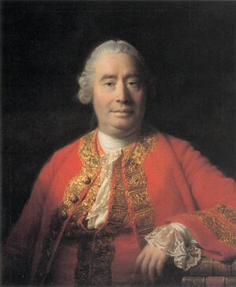

# 6부 — 철학 (2절 윤리학과 형이상학)

  
   데이비드 흄(1711~1776, 앨런 램지가 그린 초상). 1739년 『인간 본성에 관한 논고』에서 존재-당위 문제를 제기했다. 초상: 위키미디어 커먼즈, 퍼블릭 도메인

| # | 문제 | 제기 | 현황 | 주요 입장 | 비고 |
|---|---|---|---|---|---|
| 6.3 | 삶의 의미 문제 | 철학사 전반 | ❓ | 목적론적 답(신, 자연의 목적), 주관주의(개인이 의미를 구성), 허무주의(객관적 의미는 없다) 등 | 해결 기준을 정의하는 것부터 합의가 없다 |
| 6.6 | 존재-당위 문제 (흄의 길로틴) | 데이비드 흄, 1739 | ❓ | 사실 명제("~이다")에서 당위 명제("~해야 한다")를 논리적으로 끌어낼 수 없다는 문제. 윤리적 자연주의와 반자연주의가 맞선다 | — |
| 6.7 | 규범 윤리학의 통일 | 윤리학사 전반, 현대적 사고실험은 필리파 풋의 트롤리 문제(1967) | ❓ | 공리주의(최대 다수의 최대 행복), 의무론(규칙과 의무), 덕윤리(성품) 등 주요 학파가 경쟁하며, 트롤리 문제류의 사고실험에서 서로 다른 결론을 낸다 | 단일 기준으로 합의될 전망이 보이지 않는다는 것 자체가 이 분야의 특징이다 |
| 6.11 | 보편자 문제 | 고대 플라톤의 형상 이론부터 시작, 중세 스콜라철학에서 본격화 | ❓ | "빨강"이나 "인간다움" 같은 보편자가 개별 사물과 독립해서 실재하는지(실재론), 개별 사물에만 의존해 존재하는지(유명론), 개념으로만 존재하는지(개념론)를 묻는다 | — |
| 6.12 | 메타윤리학의 실재론 논쟁 | 20세기 분석철학, G. E. 무어의 『윤리학 원리』(1903) 이후 본격화 | ❓ | 도덕적 사실이 인간의 믿음과 독립적으로 객관적으로 존재하는지(도덕 실재론)와, 도덕적 판단이 태도나 감정의 표현일 뿐인지(반실재론, 정서주의)가 맞선다 | 6.6의 존재-당위 문제와 밀접하게 연결된다 |

## 신은 존재하는가

이 질문은 철학과 종교 양쪽에 걸쳐 있다. 이 아카이브에서는 종교 분야의 문제로 분류했다. [7부 7.1](../part7/01-existence-and-evil.md)에서 다룬다.

## 더 깊이 알아보기

### 6.3 삶의 의미 문제

알베르 카뮈는 1942년 『시지프 신화』에서, 영원히 바위를 산 위로 굴려 올리지만 정상에 닿는 순간 다시 굴러떨어지고 마는 형벌을 받은 그리스 신화 속 인물 시지프를 불러낸다. 카뮈가 보기에 이것이 인간 삶의 적나라한 모습이었다. 우주는 아무런 의미도 보장해 주지 않는데, 인간은 끊임없이 의미를 찾으려 한다. 그는 이 부조리를 외면하지도, 자살로 회피하지도 말고 똑바로 마주 보라고 했다. 에세이는 "시지프가 행복하다고 상상해야 한다"는 문장으로 끝맺는다. 의미가 주어지지 않는다면 반항하듯 스스로 만들어 내면 된다는 이 결론은, 삶의 의미를 둘러싼 숱한 답변 가운데서도 가장 널리 인용되는 것 중 하나로 남았다.

### 6.6 존재-당위 문제 (흄의 길로틴)

데이비드 흄은 당대 많은 도덕 철학자가 쓰던 글의 흐름을 지적했다. 한참 "이다"라는 사실을 서술하다가, 어느 순간 아무런 설명 없이 "해야 한다"는 당위로 슬쩍 넘어간다는 것이었다. 흄은 이 도약이 논리적으로 정당화된 적이 없다고 꼬집었다. 150년이 지난 1903년, G. E. 무어는 비슷한 문제의식을 "자연주의적 오류"라는 이름으로 다시 정리하며, "좋다"는 개념을 어떤 자연적 성질(쾌락, 생존 등)로 환원하려는 시도마다 "그런데 그게 정말 좋은가"라는 질문을 또 던질 수 있다는 것을 보여 줬다. 두 사람 사이에 시대 차이가 크지만, 둘 다 사실에서 가치로 건너가는 다리가 생각보다 튼튼하지 않다는 것을 짚었다는 점에서 맞닿아 있다.

### 6.7 규범 윤리학의 통일

1967년 필리파 풋이 트롤리 문제를 처음 제시했을 때, 그의 관심사는 낙태 윤리와 "이중 효과의 원칙"이었다. 자율주행차가 등장하기 반세기도 더 전의 일이다. 1985년 주디스 자비스 톰슨이 선로 위 인부 다섯 명을 구하려고 다리 위의 덩치 큰 사람을 직접 밀어 떨어뜨리는 변형판("뚱보 스위치")을 더하면서, 이 사고실험은 철학 교실을 넘어 대중문화의 단골 소재가 됐다. 그런데 뜻밖에도 이 오래된 사고실험은 수십 년 뒤 아주 실용적인 질문이 됐다. 자율주행차를 설계하는 엔지니어들이 "불가피한 사고 상황에서 차는 누구를 보호해야 하는가"라는, 트롤리 문제와 본질적으로 같은 질문을 실제 코드로 짜야 하는 처지에 놓인 것이다. 반세기 전의 사고실험이 공학 설계 문제로 되돌아온 드문 사례다.

### 6.11 보편자 문제

중세 스콜라철학에서 이 논쟁은 단순한 말장난이 아니라 신학과 직결된 중대한 문제였다. "인간다움"이나 "선함" 같은 보편자가 개별 사물과 독립해 실재로 존재한다고 본 실재론자들과, 오직 이름만 있을 뿐 실재하는 것은 개별 사물뿐이라고 본 유명론자들이 격렬히 맞섰다. 14세기 유명론을 대표한 오컴의 윌리엄은 "필요 이상으로 존재자를 늘리지 말라"는 절약의 원칙, 이른바 오컴의 면도날을 내세웠는데, 이는 보편자 같은 불필요한 실체를 상정하지 않으려는 그의 철학적 태도에서 자연스럽게 나온 것이었다. 오늘날에도 수학적 대상이나 속성이 "실재"하는지를 두고 벌어지는 논쟁은 이 중세 논쟁의 현대적 변주에 가깝다.

### 6.12 메타윤리학의 실재론 논쟁

G. E. 무어는 1903년 『윤리학 원리』에서 아주 단순하지만 끈질긴 질문법을 하나 제시했다. 누군가 "좋음이란 쾌락이다" 혹은 "좋음이란 생존에 유리한 것이다"라고 정의하면, 무어는 언제나 "그런데 그것이 정말 좋은가"라고 되물을 수 있다고 지적했다. 이 질문이 공허하지 않고 여전히 의미 있게 들린다는 사실 자체가, "좋음"을 다른 자연적 성질로 완전히 환원할 수 없다는 증거라는 것이었다. 이 "열린 질문 논증"은 20세기 메타윤리학이라는 분야를 사실상 새로 열어젖힌 출발점으로 평가받는다. 도덕적 사실이 인간의 믿음과 무관하게 객관적으로 존재하는지를 둘러싼 논쟁은, 무어 이후 한 세기가 넘도록 결론을 내지 못한 채 이어지고 있다.
