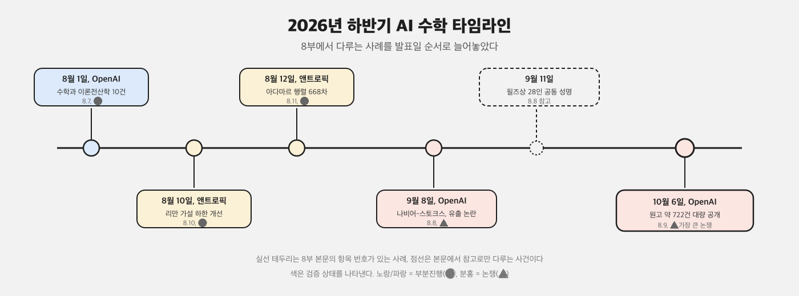

# 8부 — AI가 최근 들고 온 결과들 (2절 2026년 하반기 사례)

2026년 하반기에는 [1절](01-early-cases.md)의 속도보다 한층 빨라졌고, 동시에 "검증 없이 쏟아낸다"는 반발도 그만큼 커졌다. 번호는 8부 전체에서 공통으로 쓰는 고유 번호다.

  

| # | 과제 | AI/모델 | 발표 시점 | 기여 내용 | 검증 상태 | 출처 |
|---|---|---|---|---|---|---|
| 8.7 | 수학과 이론전산학의 미해결 문제 10건 | OpenAI (사내 차세대 모델, 공개 명칭 "Astra"로 보도) | 2026년 8월 1일, "Ten advances in mathematics and theoretical computer science" | 고차원 구 쌓기(sphere packing) 상계, 이진 코드와 구면 코드의 지수적 개선, 소픽군이 아닌 군의 존재 구성(소픽성 문제 해결), 콘느의 경직성 추측 반증, 순열식(permanent)의 산술 회로 하계, 양자 병렬 반복 정리 확장 등 10건의 결과를 발표. 린 증명서는 `openai/ten-proofs` 저장소로 공개 | 🟡 일부는 린으로 형식 검증됐지만, 공개 직후 "OpenAI가 생성한 수학 증명에 대한 인간 감사(A Human Audit of OpenAI's AI-Generated Mathematical Proofs)" 같은 독립 검토가 뒤따랐다. 전체 10건에 대한 동료 심사가 모두 끝났다고 보기는 아직 이르다 | [확인 필요: 10건 각각의 개별 검증 완료 여부] |
| 8.8 | 나비어-스토크스 방정식(매끈한 외력이 있는 경우) 해결 주장과 유출 논란 | OpenAI | 2026년 9월 8일 발표 | [1부 1.4](../part1/04-analysis-pde.md)의 나비어-스토크스 문제 중, 외력이 매끈하게 주어진 변형판에 대한 해결을 주장 | ⚠️ 심각한 논쟁. 발표 약 12시간 전, 수학자 트리스탄 버크마스터가 자신과 레벤트 알포게가 진행 중이던 오일러 방정식 관련 미공개 연구 결과가 OpenAI 쪽에 유출돼 모델에게 준 질문(프롬프트)에 영향을 줬을 수 있다고 주장했다. 2026년 9월 11일에는 필즈상 수상자 28명이 서명한 성명 "수학에서 AI의 심각한 오용(A Severe Misalignment of AI in Mathematics)"이 발표돼 AI 기업의 수학 연구 관행에 경고했다 | [확인 필요: 유출 경위에 대한 OpenAI의 공식 해명과 이후 조사 결과] |
| 8.9 | 공개 난제 약 370여 건에 대한 대량 논문 공개 | OpenAI | 2026년 10월 6일, `openai/math` 저장소 | 원고 약 722건(출처에 따라 719건), 372개 결과군을 한 번에 공개. 리만 가설([1부 1.1](../part1/01-number-theory.md)), 버치-스위너턴다이어 추측([1부 1.5](../part1/03-algebra-arithmetic-geometry.md)), 호지 추측([1부 1.2](../part1/03-algebra-arithmetic-geometry.md)) 등에 대한 "부분적 결과"를 주장했다. 아파치 2.0 라이선스로 공개하고 프린스턴 고등연구소(IAS)의 "수학과 인공지능 자문단"을 언급했다 | ⚠️ 매우 심각한 논쟁. "인간 수학을 위한 협회(Association for Human Mathematics)"가 "학문적 기여가 아니라 힘의 과시"라는 성명을 냈고, 테런스 타오가 이를 재공유하며 동의했다. 컬럼비아대 마이클 해리스, 옥스퍼드대 어슐라 마틴, MIT 앤드루 서덜랜드 등이 검증 불가능성과 재현 불가능성(모델 자체는 공개되지 않음), 기존 연구자의 미발표 성과를 가로챌 위험을 공개적으로 비판했다. 이 기록을 갱신한 시점까지 372건 각각의 검증은 끝나지 않았다 | [확인 필요: 372건 중 실제로 동료 심사를 통과한 건수. 수개월이 걸릴 것으로 보도됨] |
| 8.10 | 리만 가설 관련 하한 개선 | 앤트로픽 (미공개 연구용 클로드 모델) | 2026년 8월 10일, anthropic.com/research/riemann-zeta | 리만 제타함수의 자명하지 않은 영점 중 단순하면서 임계선 위에 있는 비율의 하한을, 아리안, 발루요트-골드스턴-수리아자야-터니지-버터보, 봄비에리 등 기존 연구 결과를 조합해 41.6%에서 67.25%로 끌어올렸다. 리만 가설 자체를 증명한 것은 아니며, 앤트로픽도 이 접근법으로는 가설 전체를 증명할 수 없다고 명시했다 | 🟡 부분진행. 앤트로픽 소속 수학자(레벤트 알포게, 랄프 퍼먼)와 외부 전문가(브라이언 콘리, 댄 골드스턴)가 결과를 검토했고 린으로 형식 검증된 증명서를 받았다. 다만 모델 자체가 공개되지 않아 독립된 재현은 아직 불가능하고, 정식 동료 심사 절차가 끝났다는 보고는 없다 | [부록 D](../appendix/d-links.md) |
| 8.11 | 아다마르 행렬 668차 등 구성 | 앤트로픽 소속 연구자들(레벤트 알포게, 필리프 보이노프, 사울 레이놀즈-하틀)과 미공개 클로드 모델 | 2026년 8월 12일 | 1893년 제기된 아다마르 추측(4의 배수인 모든 차수에 아다마르 행렬이 존재한다는 추측)에서, 이전까지 알려지지 않았던 열두 개 차수(668, 716, 892, 1132, 1244, 1388, 1436, 1676, 1772, 1916, 1948, 1964)의 구체적인 행렬 구성을 제시. 668차는 2004년 428차가 풀린 뒤로 가장 작은 미해결 차수였다 | 🟡 부분진행(잠정). AI 난제 추적 사이트 Epoch AI FrontierMath가 "AI가 해결"로 잠정 표시했으나, 사람이 핵심 아이디어에 얼마나 기여했는지에 따라 평가가 바뀔 수 있다고 단서를 달았다. 아다마르 추측 자체(모든 4의 배수 차수)는 여전히 미해결이다 | [부록 D](../appendix/d-links.md) |

## 이 부에서 특히 지키는 규칙

AI가 내놓은 결과는 발표 시점의 보도와 그 이후 학계 검토를 반드시 함께 적는다. 둘 사이에 시차가 있고, 종종 결론이 바뀐다([1절](01-early-cases.md)의 8.5, 그리고 8.9가 대표적이다). 발표 당시의 인상만 남기면 독자를 오도한다. 상태가 바뀌면 [부록 C 변경 이력](../appendix/c-changelog.md)에 날짜와 함께 기록한다.

2026년 하반기에 OpenAI와 앤트로픽 양쪽에서 대형 발표가 몰린 것은 우연이 아니다. 두 회사가 비슷한 시기에 비공개 모델의 수학 능력을 경쟁적으로 공개하고 있다는 것이 여러 보도의 공통된 해석이다. 이 아카이브는 그 경쟁 구도 자체를 평가하지 않는다. 다만 각 발표가 "검증까지 끝났는지"는 분야 표준(동료 심사, 독립 재현)에 맞춰 엄격하게 구분해 적는다.

## 더 깊이 알아보기

### 8.7 수학과 이론전산학의 미해결 문제 10건

8월 1일 공개 글의 제목은 담담하게 "열 가지 진전"이라고만 적혀 있었지만, 그 안에는 수십 년씩 묵은 문제들이 섞여 있었다. 반세기 넘게 풀리지 않던 소픽군 존재 문제, 콘느가 제기한 경직성 추측에 대한 반례까지 포함돼 있어 전산학과 수학 양쪽에서 동시에 화제가 됐다. 그런데 공개 직후 터져 나온 반응은 축하 일색이 아니었다. 독립 연구자들이 "OpenAI가 생성한 수학 증명에 대한 인간 감사"라는 제목의 검토 작업에 나섰고, 이 결과가 하반기 내내 이어질 더 큰 논쟁의 서막이라는 것을 그때는 많은 사람이 미처 알지 못했다.

### 8.8 나비어-스토크스 방정식 해결 주장과 유출 논란

발표를 불과 열두 시간 앞두고, 수학자 트리스탄 버크마스터는 자신과 레벤트 알포게가 공개하지 않고 진행 중이던 오일러 방정식 연구가 OpenAI 쪽에 유출된 것 같다는 글을 올렸다. 그의 의심이 맞는지는 끝까지 공식적으로 확인되지 않았지만, 타이밍이 공교로웠다. 사흘 뒤 뉴욕타임스를 비롯한 여러 매체가 이 의혹을 취재해 보도했고, 열흘 뒤인 9월 11일에는 필즈상 수상자 28명이 "수학에서 AI의 심각한 오용"이라는 제목의 공동 성명에 이름을 올렸다. 한 건의 해결 주장이 열흘 만에 수학계 전체의 집단적 경고로 번진 셈이다.

### 8.9 공개 난제 약 370여 건에 대한 대량 논문 공개

10월 6일 화요일, 수학자들은 아침부터 자신의 메일함과 소셜미디어 타임라인이 같은 소식으로 뒤덮이는 것을 지켜봤다. 722건에 달하는 원고가 한꺼번에 저장소에 올라온 것이다. 다음 날, "인간 수학을 위한 협회"는 성명을 내며 "700건 넘는 파일을 한꺼번에 공개하는 것은 학문적 기여가 아니라 힘의 과시"라고 선언했다. 테런스 타오가 이 성명을 자신의 채널에 공유하며 동의를 표하자 논쟁은 더 커졌다. 컬럼비아대의 마이클 해리스는 "이 논문들을 들여다볼 시간을 낼 수 없다. 읽지 않을 것"이라고 잘라 말했고, 옥스퍼드대의 어슐라 마틴은 "지저분한 초안을 커뮤니티에 던져 놓고 우리더러 정리하라는 셈"이라고 비판했다. 몇몇 연구자는 이 사건에 "스쿠폴립스(대량 발표로 벌어진 아수라장)"라는 별명을 붙이기도 했다. 발표 당일의 충격과, 그 뒤로 몇 달이 걸릴 검증 작업 사이의 간극이 이보다 크게 벌어진 적은 드물었다.

### 8.10 리만 가설 관련 하한 개선

이 결과의 시작은 거창하지 않았다. 앤트로픽 직원 재러드 섬너는 수학에 특별한 전문성이 없었지만, 사내 코딩 도구 안에서 미공개 클로드 모델에게 "진짜로 한번 제대로 도전해 보라"고 가볍게 주문했다. 그러고는 모델이 하루 반 동안 스스로 방향을 정하도록 내버려 뒀다. 모델은 60개의 하위 작업을 동시에 돌리며 650개의 아이디어를 시도했고, 그중 쓸모 있는 핵심 아이디어를 낸 것은 둘뿐이었다고 나중에 공개된 보고서는 밝혔다. 나머지는 아이디어를 보태거나, 검증을 맡거나, 끝내 실패한 시도들이었다. 리만 가설을 증명하지는 못했지만, 41.6%에 머물러 있던 기존 수학자들의 하한 기록을 단번에 67.25%까지 끌어올린 이 결과는, 가벼운 요청 하나가 어디까지 이어질 수 있는지를 보여 준 사례로 남았다.

### 8.11 아다마르 행렬 668차 등 구성

이 결과가 공개됐을 때, 참여 연구자 중 한 명인 레벤트 알포게는 자신의 소셜미디어에 공동 연구자들의 이름을 나열하며 이렇게 덧붙였다. "그리고 물론 클로드도요. 저는 그냥 나쁜 제안만 했어요." 장난스러운 농담이었지만, 그 안에는 AI가 핵심 아이디어를 내고 사람이 다듬는 역할을 했다는 암시가 담겨 있었다. 공교롭게도 2015년 테런스 타오는 이 668이라는 숫자를 두고 "잡지 퍼즐로는 추천하지 않는다"고 농담한 적이 있었다. 11년 뒤, 그 농담 속 숫자가 AI와 사람이 함께 만든 구성으로 풀렸다. 다만 Epoch AI의 FrontierMath 트래커는 이를 "잠정적으로 AI가 해결"이라고 표시하면서도, 사람의 기여도에 따라 평가가 바뀔 수 있다는 단서를 분명히 달아 뒀다.
